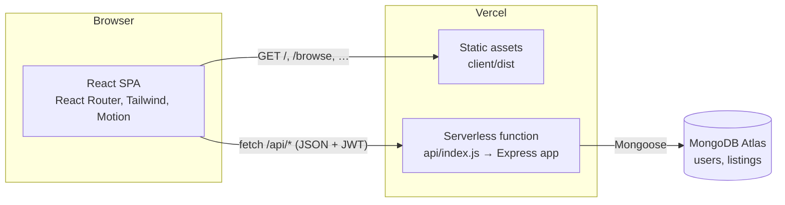

# MealBridge

**Rescue surplus food before it spoils.** MealBridge connects restaurants, hostel messes, caterers and bakeries that have leftover food with NGOs, shelters and volunteers nearby who can collect it and feed people.

| | |
|---|---|
| **Live app** | __LIVE_URL__ |
| **Source** | https://github.com/pushpam2404/mealbridge |
| **Course** | Web Application Framework |
| **Student** | Pushpam Raj Satyarthi |
| **Roll number** | 2024107717 |
| **Branch** | CSE-Core |

**Try it without signing up:** open the app, go to *Sign in*, and use **Try as a kitchen** or **Try as an NGO**. Both demo accounts use the password `demo1234`.

| Role | Email | Organisation |
|---|---|---|
| Donor (kitchen) | `donor@mealbridge.app` | Spice Route Kitchen, Pune |
| Receiver (NGO) | `ngo@mealbridge.app` | Roti Bank Foundation, Pune |


---

## The problem

India wastes tens of millions of tonnes of food every year, and a large share of it is cooked food from restaurants, hostels, weddings and corporate canteens that was never served. At the same time, NGOs and night shelters struggle to source enough meals. The food usually exists **a few kilometres away**, but nobody knows it's there, and cooked food has a window of only a few hours.

MealBridge closes that gap with a simple, time-aware marketplace:

1. **A kitchen posts its surplus**: what it is, how many people it feeds, the pickup window, and when it stops being safe to eat.
2. **A nearby NGO claims it.** Claims are atomic, so two NGOs can never claim the same food. Contact details are shared only between the two parties.
3. **They collect it and confirm.** The meals are added to the public impact report.

Listings automatically come off the board once their best-before time passes.

## Features

**For donors (kitchens)**
- Post, edit, cancel and delete surplus food listings (full CRUD)
- Quick time presets ("Ready now", "After dinner service", "Tomorrow morning")
- Category, veg / non-veg / vegan marking (Indian FSSAI-style symbol), allergen tags
- Dashboard tabs for *Waiting for a claim*, *Being collected* and *History*
- See who is collecting, their phone and email, and a pickup code to verify them
- Personal impact: meals donated, kg rescued, CO₂e avoided

**For receivers (NGOs and volunteers)**
- Live board of open listings, soonest-expiring first, with countdown timers
- Search, city filter, category and food-type filters, sorting, pagination (all reflected in the URL, so filtered views can be shared)
- One-tap claim with confirmation, release a claim, confirm collection
- Pickup code and donor contact details once claimed

**For everyone**
- Public impact report with weekly and per-category charts plus table views
- Responsive from 360 px phones to wide desktops, with light and dark themes
- Accessible: semantic HTML, labelled form controls, keyboard-friendly dialogs with focus trapping, skip link, visible focus rings, `prefers-reduced-motion` respected
- Motion design with [Motion](https://motion.dev): tickets drop onto the pickup board, shared-layout filter chips and tab indicators, animated list changes, spring-based dialogs

## Tech stack

| Layer | Technology |
|---|---|
| Frontend | **React 19**, React Router 8, Vite 8, **Tailwind CSS 4**, Motion (motion.dev), Recharts, lucide-react icons, Sonner toasts |
| Backend | **Node.js** + **Express 5** (REST API), Zod validation, JWT auth (jsonwebtoken), bcryptjs, Helmet, CORS, express-rate-limit |
| Database | **MongoDB Atlas** via **Mongoose 9** |
| Testing | Vitest + Supertest + mongodb-memory-server (21 API tests) |
| Hosting | **Vercel**: static React build plus Express running as a serverless function |

## Architecture



- One Vercel project serves both halves. `vercel.json` rewrites `/api/*` to the Express function and everything else to the SPA's `index.html`.
- The Mongoose connection is cached on `globalThis`, so warm serverless invocations reuse it instead of reconnecting.
- Locally, `server/server.js` runs the same Express app on port 5050, and Vite proxies `/api` to it.

```
mealbridge/
├── api/index.js                 # Vercel entry: exports the Express app
├── server/
│   ├── server.js                # Local entry: app.listen()
│   ├── src/
│   │   ├── app.js               # Express app factory, middleware, routes
│   │   ├── db.js                # Cached Mongoose connection
│   │   ├── models/              # User, Listing (Mongoose schemas)
│   │   ├── routes/              # auth, listings, stats
│   │   ├── middleware/          # JWT auth, Zod validation, error handler
│   │   └── utils/               # impact maths, HttpError
│   ├── scripts/seed.js          # Demo users and listings
│   └── tests/                   # Vitest + Supertest API tests
├── client/
│   ├── index.html
│   └── src/
│       ├── pages/               # Home, Browse, ListingDetail, ListingEditor, Dashboard, Impact, AuthPage
│       ├── components/          # Ticket, Modal, Layout, FoodMark, StatusStamp, ui primitives
│       ├── context/             # AuthContext (JWT session)
│       ├── hooks/               # useAsync, useNow, useTheme, useTitle
│       └── lib/                 # api client, formatting, constants
└── vercel.json
```

## Data model

**User**

| Field | Type | Notes |
|---|---|---|
| name, email | String | email is unique and lower-cased |
| passwordHash | String | bcrypt hash, never returned by the API |
| role | `donor` \| `receiver` | decides what the user can do |
| organization, phone, city | String | phone and email are shared only with the other side of a pickup |

**Listing**

| Field | Type | Notes |
|---|---|---|
| donor | ObjectId → User | owner |
| title, description | String | |
| category | `cooked` `bakery` `produce` `packaged` `dairy` `beverages` | |
| foodType | `veg` `non-veg` `vegan` | |
| quantity, unit | Number, `kg` `servings` `items` | |
| estServings | Number | how many people it feeds |
| allergens | [String] | |
| pickupAddress, city | String | |
| pickupStart, pickupEnd, expiresAt | Date | validated: end after start, expiry in the future and not before pickup ends |
| status | `available` → `claimed` → `completed`, or `expired` / `cancelled` | |
| claimedBy, claimedAt, completedAt | | set by the claim and complete actions |

Indexes on `{status, city, expiresAt}`, `donor`, `claimedBy`, plus a text index.

## REST API

Base URL: `/api`. Request and response bodies are JSON. Protected routes need `Authorization: Bearer <token>`. Errors always look like `{ "error": "message", "fields": { "field": "problem" } }`.

| Method | Endpoint | Auth | Description |
|---|---|---|---|
| GET | `/health` | none | Liveness check and database status |
| POST | `/auth/register` | none | Create an account. Returns `{ token, user }` |
| POST | `/auth/login` | none | Log in. Returns `{ token, user }` |
| GET | `/auth/me` | any | Current user |
| PATCH | `/auth/me` | any | Update name, organisation, phone, city |
| GET | `/listings` | none | List listings. Query: `q`, `status` (default `available`, or `all`), `category`, `foodType`, `city`, `sort` (`expiring` / `newest` / `largest`), `page`, `limit` |
| GET | `/listings/cities` | none | Cities that have open listings |
| GET | `/listings/mine` | any | Donor: own listings. Receiver: own claims |
| GET | `/listings/:id` | optional | One listing. Contact details only for the donor and the claimer |
| POST | `/listings` | donor | **Create** a listing |
| PATCH | `/listings/:id` | owner | **Update** a listing (only while available) |
| DELETE | `/listings/:id` | owner | **Delete** a listing (not while someone is collecting it) |
| POST | `/listings/:id/claim` | receiver | Claim. Atomic, so returns `409` if someone else got there first |
| POST | `/listings/:id/unclaim` | claimer | Release a claim |
| POST | `/listings/:id/complete` | owner or claimer | Confirm pickup |
| POST | `/listings/:id/cancel` | owner | Cancel a listing |
| GET | `/stats` | none | Totals, weekly series, category breakdown, community counts |
| GET | `/stats/me` | any | The signed-in user's impact |

Example:

```bash
# Log in as the demo kitchen
TOKEN=$(curl -s -X POST __LIVE_URL__/api/auth/login \
  -H 'Content-Type: application/json' \
  -d '{"email":"donor@mealbridge.app","password":"demo1234"}' | jq -r .token)

# Post surplus food
curl -X POST __LIVE_URL__/api/listings \
  -H "Authorization: Bearer $TOKEN" -H 'Content-Type: application/json' \
  -d '{"title":"Veg pulao","category":"cooked","foodType":"veg","quantity":6,"unit":"kg",
       "estServings":20,"pickupAddress":"Shop 4, Koregaon Park","city":"Pune",
       "pickupStart":"2026-10-26T13:00:00Z","pickupEnd":"2026-10-26T15:00:00Z",
       "expiresAt":"2026-10-26T18:00:00Z"}'
```

## Running locally

Requirements: Node.js 20 or newer.

```bash
git clone https://github.com/pushpam2404/mealbridge.git
cd mealbridge
npm install
npm --prefix client install
```

**Option A: no database setup.** This starts an in-memory MongoDB, seeds demo data, and runs the API and the React dev server together:

```bash
npm run dev:memory
# open http://localhost:5173
```

**Option B: your own MongoDB** (local or Atlas):

```bash
cp .env.example .env      # then set MONGODB_URI and JWT_SECRET
npm run seed              # resets the database and loads demo data
npm run dev               # API on :5050, web on :5173
```

Other scripts:

| Command | What it does |
|---|---|
| `npm test` | Runs the API test suite against an in-memory MongoDB |
| `npm run build` | Builds the React app into `client/dist` |
| `npm start` | Runs the API only |

## Environment variables

| Variable | Required | Description |
|---|---|---|
| `MONGODB_URI` | yes | MongoDB connection string |
| `JWT_SECRET` | yes | Secret for signing login tokens |
| `CORS_ORIGIN` | no | Comma-separated allowed origins (defaults to any, since the frontend is same-origin) |
| `PORT` | no | Local API port (default 5050) |

## Deployment (Vercel + MongoDB Atlas, both free)

1. Create a free **M0** cluster on [MongoDB Atlas](https://www.mongodb.com/cloud/atlas). Add a database user, allow network access from `0.0.0.0/0` (Vercel's IPs are dynamic), and copy the connection string.
2. Import the GitHub repo into Vercel. `vercel.json` already sets the build command, output directory and rewrites.
3. Add `MONGODB_URI` and `JWT_SECRET` under *Project, Settings, Environment Variables*.
4. Deploy, then seed once from your machine: `vercel env pull .env && npm run seed`.

Every push to `main` redeploys automatically.

## Testing

```bash
npm test
```

21 integration tests cover registration and login, validation errors, duplicate emails, ownership rules on update and delete, the claim → complete lifecycle, concurrent claims (only one wins), releasing claims, lazy expiry of stale listings, private contact details, and impact statistics.

## Screenshots

| Browse (desktop) | Listing claimed by an NGO |
|---|---|
|  |  |

| Donor dashboard | Impact report |
|---|---|
|  |  |

| Mobile: home | Mobile: browse | Dark theme |
|---|---|---|
|  |  |  |

## How the impact numbers work

- **Meals** are the donor's estimate of how many people a listing feeds.
- **Weight** is the listed weight for listings in kg, otherwise 0.4 kg per serving.
- **CO₂e avoided** is 2.5 kg per kg of food kept out of landfill.
- Only **completed** pickups count. Expired and cancelled listings are excluded.

## License

MIT. See [LICENSE](LICENSE).
