# MealBridge

[](https://github.com/pushpam2404/mealbridge/actions/workflows/ci.yml)

MealBridge connects restaurants, hostel messes, caterers and bakeries that have leftover food with NGOs, shelters and volunteers nearby who can collect it. It is a MERN app (MongoDB, Express, React, Node) built for the Web Application Framework course.

| | |
|---|---|
| Live app | https://mealbridge-app.vercel.app |
| Source | https://github.com/pushpam2404/mealbridge |
| Course | Web Application Framework |
| Student | Pushpam Raj Satyarthi |

To try it without signing up, open the app, go to Sign in, and use "Try as a kitchen" or "Try as an NGO". Both demo accounts use the password `demo1234`.

| Role | Email | Organisation |
|---|---|---|
| Donor (kitchen) | `donor@mealbridge.app` | Spice Route Kitchen, Pune |
| Receiver (NGO) | `ngo@mealbridge.app` | Roti Bank Foundation, Pune |

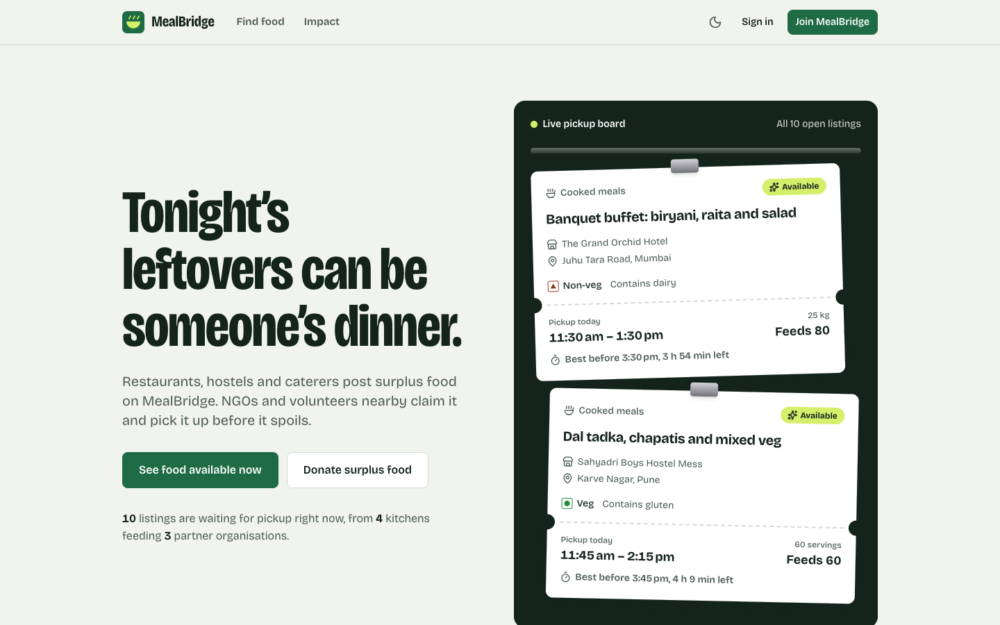

---

## The problem

A lot of cooked food from restaurants, hostels, weddings and canteens is never served, while NGOs and night shelters struggle to source meals. The surplus is usually a few kilometres from someone who needs it, but cooked food only stays safe for a few hours, so nobody finds out in time.

MealBridge is a small marketplace built around that time limit:

1. A kitchen posts its surplus: what it is, how many people it feeds, the pickup window, and when it stops being safe to eat.
2. A nearby NGO claims it. Claims are atomic, so two NGOs cannot claim the same food. Contact details are shared only between the two parties.
3. They collect it and confirm. The meals are added to the public impact report.

Listings come off the board on their own once the best-before time passes.

## Features

Donors (kitchens) can post, edit, cancel and delete listings, use time presets such as "Ready now" or "After dinner service", mark veg / non-veg / vegan with the FSSAI-style symbol, and tag allergens. The dashboard splits listings into waiting for a claim, being collected and history. Once someone claims a listing, the donor sees who is collecting it, their phone and email, and a pickup code to check at handover. There is also a personal impact tally (meals, kg, CO2e).

Receivers (NGOs and volunteers) see a live board of open listings, soonest-expiring first, with countdown timers. Search, city, category and food-type filters, sorting and pagination all live in the URL, so a filtered view can be shared. Claiming takes one tap plus a confirmation. A claim can be released, and a pickup confirmed once the food is collected.

Everyone can open the public impact report, which has weekly and per-category charts, each with a table view. The layout works from 360 px phones to wide desktops, in light and dark themes. Dialogs trap focus, there is a skip link, focus rings are visible, form errors are announced, and `prefers-reduced-motion` is respected. Animation uses [Motion](https://motion.dev): tickets drop onto the pickup board, filter chips and tabs share a moving indicator, dialogs use springs.

## Tech stack

| Layer | Technology |
|---|---|
| Frontend | **React 19**, React Router 8, Vite 8, **Tailwind CSS 4**, Motion (motion.dev), Recharts, lucide-react icons, Sonner toasts |
| Backend | **Node.js** + **Express 5** (REST API), Zod validation, JWT auth (jsonwebtoken), bcryptjs, Helmet, CORS, express-rate-limit |
| Database | **MongoDB Atlas** via **Mongoose 9** |
| Testing | Vitest, Supertest, mongodb-memory-server |
| CI | GitHub Actions: lint, tests, build on every push and pull request |
| Hosting | **Vercel**: static React build plus Express running as a serverless function |

## Architecture

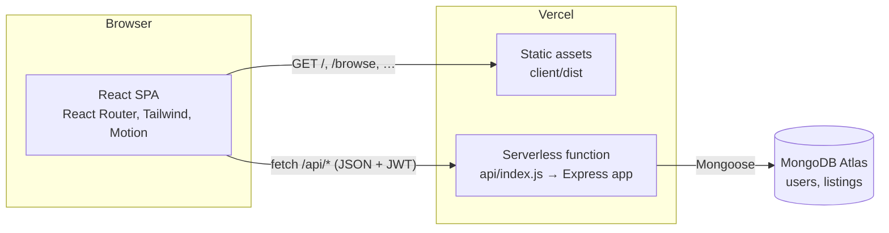

- One Vercel project serves both halves. `vercel.json` rewrites `/api/*` to the Express function and everything else to the SPA's `index.html`.
- The Mongoose connection is cached on `globalThis`, so warm serverless invocations reuse it instead of reconnecting.
- The function runs in Vercel's Mumbai region (`bom1`), next to the Atlas cluster in AWS `ap-south-1`.
- Locally, `server/server.js` runs the same Express app on port 5050, and Vite proxies `/api` to it. If 5050 is taken, start the dev servers with `PORT` exported in the shell, for example `PORT=5051 npm run dev:memory`, and the proxy follows it.

```
mealbridge/
├── .github/workflows/ci.yml     # lint, test, build
├── api/index.js                 # Vercel entry: exports the Express app
├── server/
│   ├── server.js                # Local entry: app.listen()
│   ├── src/
│   │   ├── app.js               # Express app factory, middleware, routes
│   │   ├── db.js                # Cached Mongoose connection
│   │   ├── models/              # User, Listing (Mongoose schemas)
│   │   ├── routes/              # auth, listings, stats
│   │   ├── middleware/          # JWT auth, Zod validation, error handler
│   │   └── utils/               # impact maths, HttpError
│   ├── scripts/seed.js          # Demo users and listings
│   └── tests/                   # Vitest + Supertest API tests, unit tests, CSP guard
├── client/
│   ├── index.html
│   └── src/
│       ├── pages/               # Home, Browse, ListingDetail, ListingEditor, Dashboard, Impact, AuthPage
│       ├── components/          # Ticket, Modal, Layout, FoodMark, StatusStamp, ui primitives
│       ├── context/             # AuthContext (JWT session)
│       ├── hooks/               # useAsync, useNow, useTheme, useTitle
│       └── lib/                 # api client, formatting (with tests), constants
└── vercel.json
```

## Data model

**User**

| Field | Type | Notes |
|---|---|---|
| name, email | String | email is unique and lower-cased |
| passwordHash | String | bcrypt hash, never returned by the API |
| role | `donor` \| `receiver` | decides what the user can do |
| organization, phone, city | String | phone and email are shared only with the other side of a pickup |

**Listing**

| Field | Type | Notes |
|---|---|---|
| donor | ObjectId → User | owner |
| title, description | String | |
| category | `cooked` `bakery` `produce` `packaged` `dairy` `beverages` | |
| foodType | `veg` `non-veg` `vegan` | |
| quantity, unit | Number, `kg` `servings` `items` | |
| estServings | Number | how many people it feeds |
| allergens | [String] | |
| pickupAddress, city | String | |
| pickupStart, pickupEnd, expiresAt | Date | validated: end after start, expiry in the future and not before pickup ends |
| status | `available` → `claimed` → `completed`, or `expired` / `cancelled` | |
| claimedBy, claimedAt, completedAt | | set by the claim and complete actions |

Indexes on `{status, city, expiresAt}`, `donor`, `claimedBy`, plus a text index.

## REST API

Base URL: `/api`. Request and response bodies are JSON. Protected routes need `Authorization: Bearer <token>`. Errors always look like `{ "error": "message", "fields": { "field": "problem" } }`.

| Method | Endpoint | Auth | Description |
|---|---|---|---|
| GET | `/health` | none | Liveness check and database status |
| POST | `/auth/register` | none | Create an account. Returns `{ token, user }` |
| POST | `/auth/login` | none | Log in. Returns `{ token, user }` |
| GET | `/auth/me` | any | Current user |
| PATCH | `/auth/me` | any | Update name, organisation, phone, city |
| GET | `/listings` | none | List listings. Query: `q`, `status` (default `available`, or `all`), `category`, `foodType`, `city`, `sort` (`expiring` / `newest` / `largest`), `page`, `limit` |
| GET | `/listings/cities` | none | Cities that have open listings |
| GET | `/listings/mine` | any | Donor: own listings. Receiver: own claims |
| GET | `/listings/:id` | optional | One listing. Contact details only for the donor and the claimer |
| POST | `/listings` | donor | **Create** a listing |
| PATCH | `/listings/:id` | owner | **Update** a listing (only while available) |
| DELETE | `/listings/:id` | owner | **Delete** a listing (not while someone is collecting it) |
| POST | `/listings/:id/claim` | receiver | Claim. Atomic, so returns `409` if someone else got there first |
| POST | `/listings/:id/unclaim` | claimer | Release a claim |
| POST | `/listings/:id/complete` | owner or claimer | Confirm pickup |
| POST | `/listings/:id/cancel` | owner | Cancel a listing |
| GET | `/stats` | none | Totals, weekly series, category breakdown, community counts |
| GET | `/stats/me` | any | The signed-in user's impact |

Example:

```bash
# Log in as the demo kitchen
TOKEN=$(curl -s -X POST https://mealbridge-app.vercel.app/api/auth/login \
  -H 'Content-Type: application/json' \
  -d '{"email":"donor@mealbridge.app","password":"demo1234"}' | jq -r .token)

# Post surplus food
curl -X POST https://mealbridge-app.vercel.app/api/listings \
  -H "Authorization: Bearer $TOKEN" -H 'Content-Type: application/json' \
  -d '{"title":"Veg pulao","category":"cooked","foodType":"veg","quantity":6,"unit":"kg",
       "estServings":20,"pickupAddress":"Shop 4, Koregaon Park","city":"Pune",
       "pickupStart":"2026-10-26T13:00:00Z","pickupEnd":"2026-10-26T15:00:00Z",
       "expiresAt":"2026-10-26T18:00:00Z"}'
```

## Running locally

Requirements: Node.js 20 or newer.

```bash
git clone https://github.com/pushpam2404/mealbridge.git
cd mealbridge
npm install
npm --prefix client install
```

**Option A: no database setup.** This starts an in-memory MongoDB, seeds demo data, and runs the API and the React dev server together:

```bash
npm run dev:memory
# open http://localhost:5173
```

**Option B: your own MongoDB** (local or Atlas):

```bash
cp .env.example .env      # then set MONGODB_URI and JWT_SECRET
npm run seed              # resets the database and loads demo data
npm run dev               # API on :5050, web on :5173
```

Other scripts:

| Command | What it does |
|---|---|
| `npm test` | Runs the API tests (against an in-memory MongoDB) and the client unit tests |
| `npm run lint` | Lints the React app with oxlint |
| `npm run build` | Builds the React app into `client/dist` |
| `npm start` | Runs the API only |

## Environment variables

| Variable | Required | Description |
|---|---|---|
| `MONGODB_URI` | yes | MongoDB connection string |
| `JWT_SECRET` | yes | Secret for signing login tokens. Use a long random string, for example `openssl rand -base64 48` |
| `DEMO_MODE` | no | `true` re-posts the demo kitchens' listings with fresh pickup times once they expire or are collected, so the public demo never shows an empty board (checked at most every 5 minutes) |
| `CORS_ORIGIN` | no | Comma-separated allowed origins. Defaults to any origin, which is fine here because the frontend is same-origin and auth uses a bearer token, not cookies |
| `PORT` | no | Local API port (default 5050). The Vite dev proxy only sees it when it is exported in the shell, not when it is set in `.env` |

## Deployment (Vercel + MongoDB Atlas, both free)

1. Create a free **M0** cluster on [MongoDB Atlas](https://www.mongodb.com/cloud/atlas). Add a database user, allow network access from `0.0.0.0/0` (Vercel's IPs are dynamic), and copy the connection string.
2. Import the GitHub repo into Vercel. `vercel.json` already sets the build command, output directory and rewrites.
3. Add `MONGODB_URI`, `JWT_SECRET` and (for a public demo) `DEMO_MODE=true` under *Project, Settings, Environment Variables*. `vercel.json` pins the function to `bom1` (Mumbai) so it sits next to an Atlas cluster in `ap-south-1`.
4. Deploy, then seed once from your machine: `vercel env pull .env && npm run seed`.

Every push to `main` redeploys automatically.

## Testing

```bash
npm test
```

There are 40 tests. The API tests run the real Express app against an in-memory MongoDB and cover registration and login, validation errors, duplicate emails, ownership rules, the claim, complete and release lifecycle, two simultaneous claims (only one wins), lazy expiry of stale listings, private contact details, partial updates that must not wipe other fields, forged and expired tokens, operator objects in login bodies, oversized bodies, impact statistics and demo mode. Smaller unit tests cover the impact maths and the client's date and freshness formatting. One test checks that the inline theme script in `client/index.html` still matches the hash allowed by the Content-Security-Policy in `vercel.json`.

GitHub Actions runs lint, the tests and the production build on every push and pull request (`.github/workflows/ci.yml`).

## Security notes

- Request bodies and query strings go through Zod schemas before they reach Mongoose, so objects like `{"$ne": null}` are rejected rather than treated as queries. Search text is regex-escaped.
- Passwords are hashed with bcrypt. Tokens are HS256 JWTs that expire after 7 days, and the algorithm is pinned when verifying.
- The auth routes are rate limited (50 requests per 15 minutes per IP). The limiter is in memory, so on Vercel each warm function instance counts separately.
- The API sends Helmet's headers. The static site gets a Content-Security-Policy and other headers from `vercel.json`.
- Phone and email are only returned to the donor and the receiver who claimed that listing.

## Limitations

- Tokens live in `localStorage`, so an XSS bug would expose them. The CSP and React's escaping reduce that risk, but an httpOnly cookie would be safer.
- There is no email verification or password reset, and nothing checks that a donor or NGO is who they say they are. Anyone can register as either.
- Location is a free-text city, not coordinates, so there is no "near me" search.
- Listings have no photos.
- Impact numbers rest on donor estimates and fixed conversion factors.
- Expired listings are flipped when someone reads the board, not by a scheduled job.
- The rate limiter is per instance (see above) and there is no limit on other routes.

## Roadmap

- Geocode addresses and sort by distance.
- Email or WhatsApp notification when a listing is claimed or about to expire.
- Move the session to an httpOnly cookie with CSRF protection.
- Photo upload for listings.
- A shared rate-limit store for the serverless deployment.

## Screenshots

| Browse (desktop) | Listing claimed by an NGO |
|---|---|
| 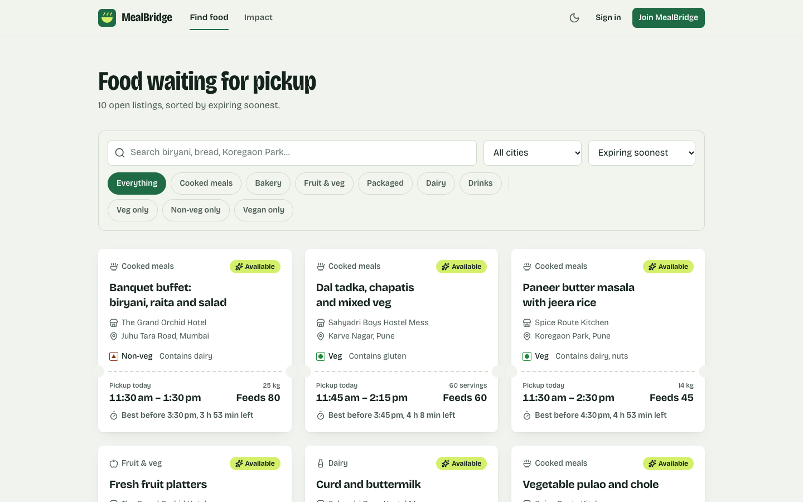 | 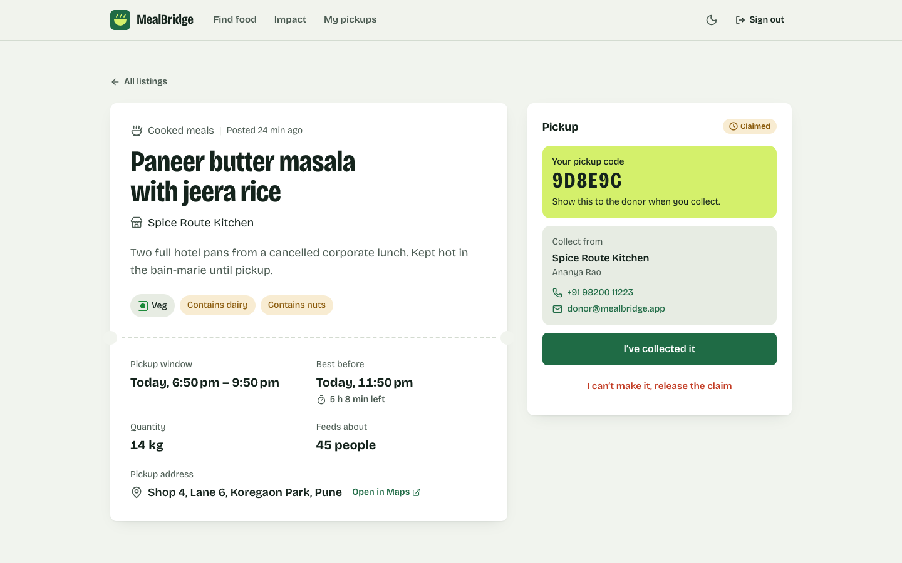 |

| Donor dashboard | Post a listing |
|---|---|
| 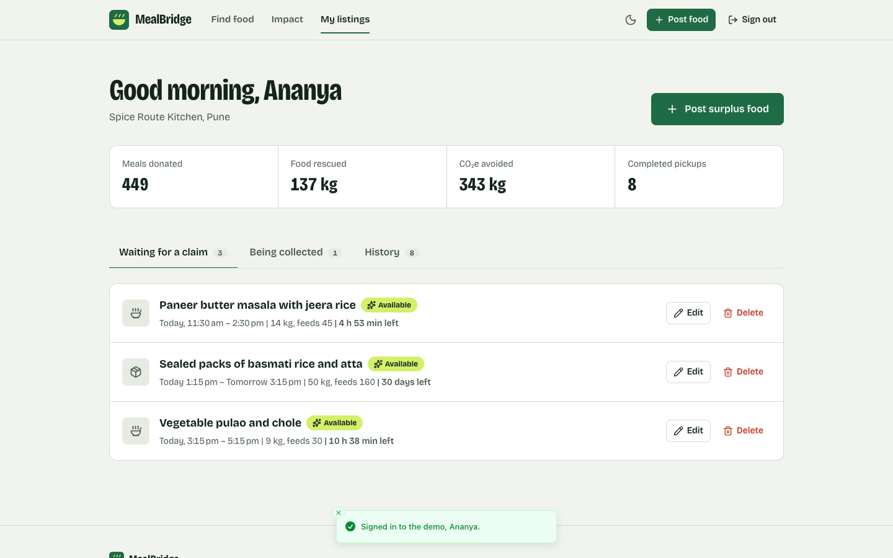 | 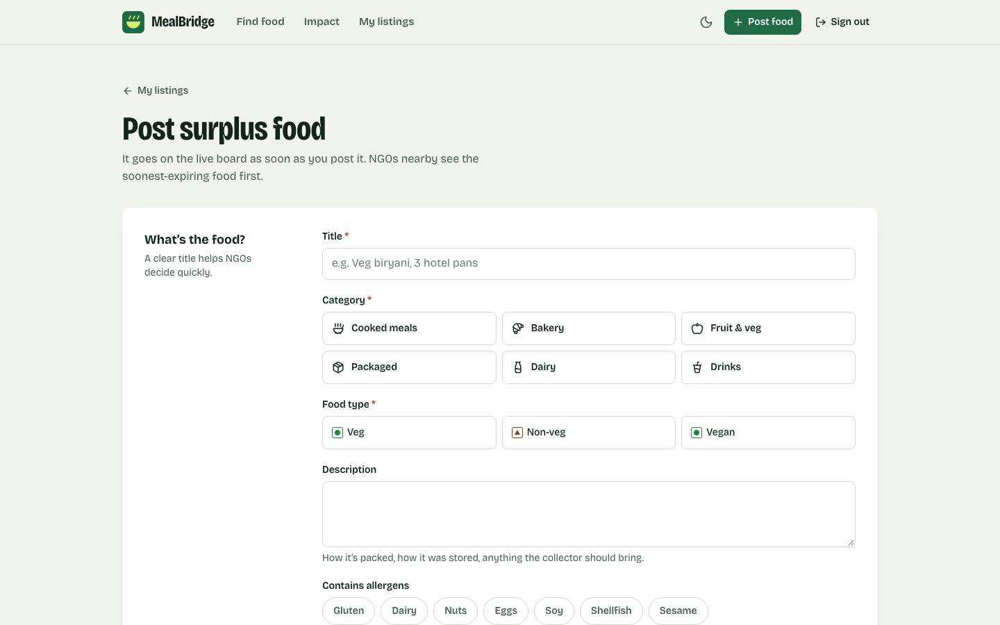 |

| Impact report | Dark theme |
|---|---|
| 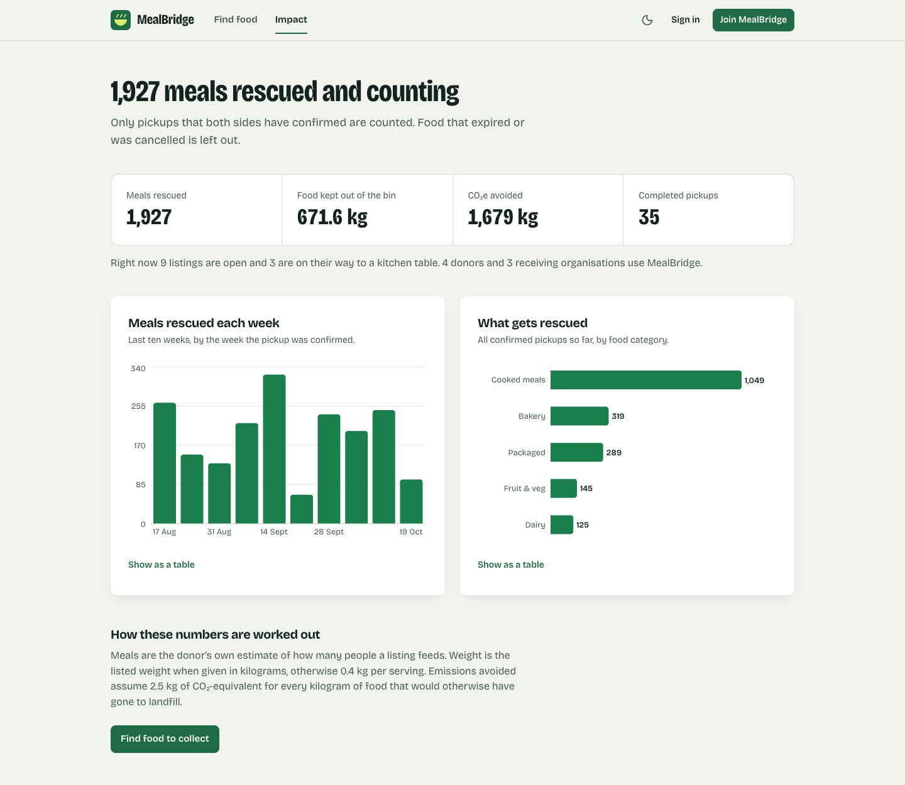 | 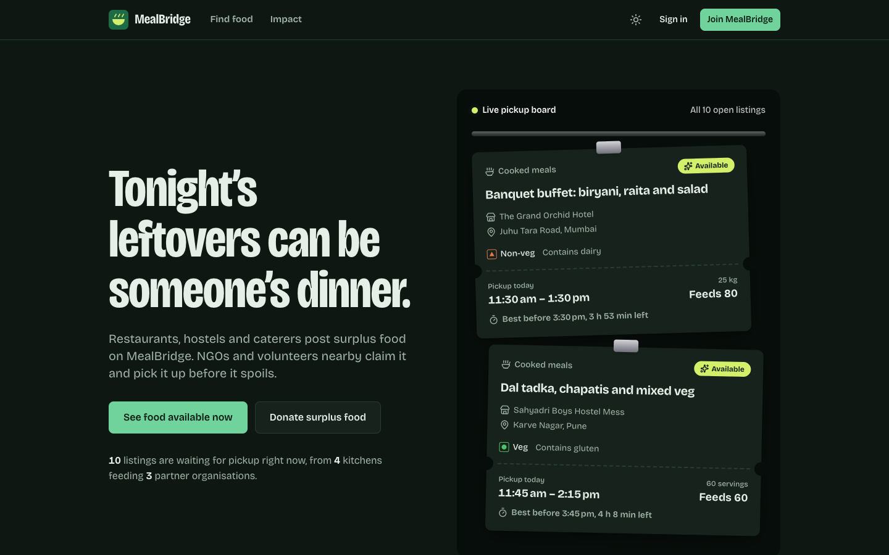 |

| Mobile: home | Mobile: browse | Mobile: dashboard |
|---|---|---|
| 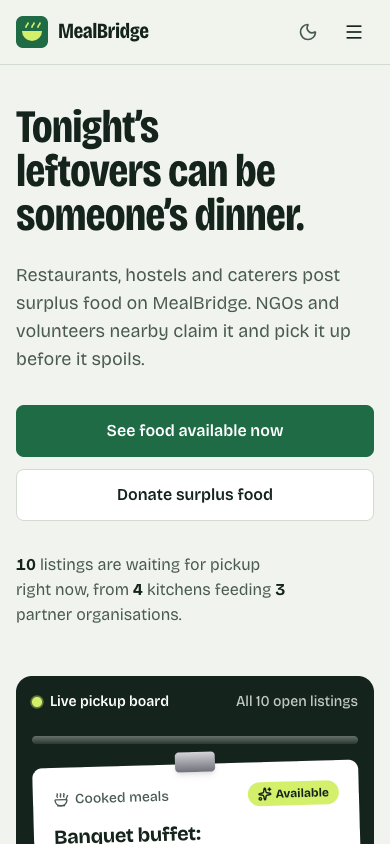 | 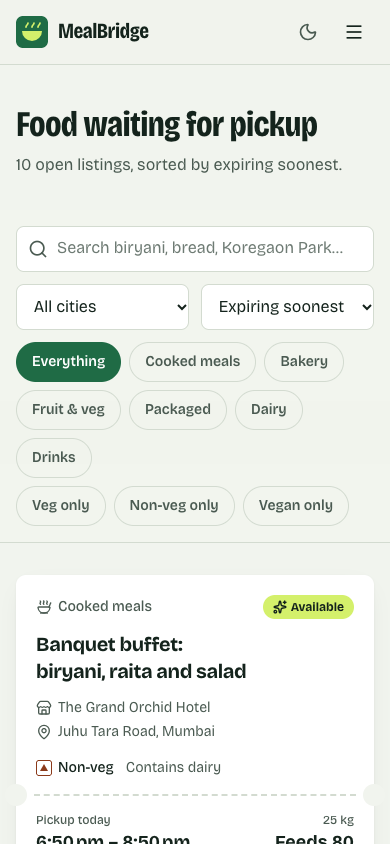 | 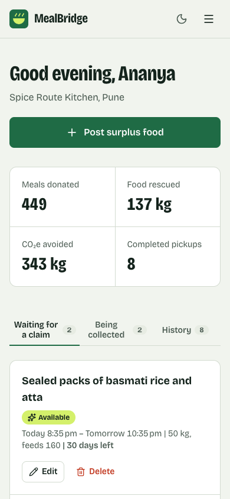 |

## How the impact numbers work

- **Meals** are the donor's estimate of how many people a listing feeds.
- **Weight** is the listed weight for listings in kg, otherwise 0.4 kg per serving.
- **CO₂e avoided** is 2.5 kg per kg of food kept out of landfill.
- Only **completed** pickups count. Expired and cancelled listings are excluded.

## License

MIT. See [LICENSE](LICENSE).
